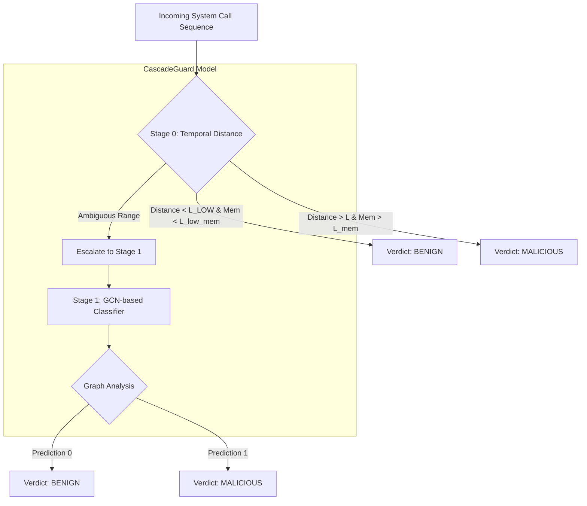

# Study Report: Evaluating the CascadeGuard Defense against Mimicry Attacks

## 1. Introduction & Dataset
This study evaluates the effectiveness of the **CascadeGuard** model in detecting system intrusions, specifically focusing on its robustness against mimicry attacks.

### The ADFA-LD Dataset
The evaluation is conducted using the **ADFA-LD (Linux Dataset)**, a real-world dataset of system call traces. Unlike synthetic benchmarks, ADFA-LD provides a realistic representation of system behavior, where normal and attack distributions often overlap significantly. 

**Dataset characteristics used in this study:**
- **Normal Traces:** Used to build the baseline behavior of the system.
- **Attack Traces:** Genuine attack sequences used for both calibration and evaluation.
- **Mimicry Traces:** Attack sequences that have been tampered with by injecting "filler" benign n-grams to deceive distance-based detectors (like Tier 1).

---

## 2. The CascadeGuard Architecture

### Overview
**CascadeGuard (Tier 3)** is a multi-stage detection pipeline designed to balance low-latency response with high-accuracy deep analysis. It acts as a "filter," where simple cases are handled quickly and ambiguous cases are escalated to a more sophisticated graph-based classifier.

### Architecture Diagram

### In-Depth Component Analysis

#### Stage 0: Temporal Memory & Distance
Stage 0 is the "fast path." It computes a **normalized distance** between the current sequence and a known-good baseline. 
- **Temporal Memory:** To combat mimicry (where attackers dilute their signature), CascadeGuard uses a chunk-based memory system. It slices the sequence into chunks and computes scores across these windows, ensuring that a small "cluster" of malicious activity cannot be hidden by a large amount of benign padding.
- **The Gate:** A set of calibrated thresholds ($L, L_{low}, L_{mem}, L_{low\_mem}$) determines if a sequence is clearly benign, clearly malicious, or requires further investigation.

#### Stage 1: Graph-based Structural Analysis
When Stage 0 escalates a trace, Stage 1 performs a deep structural analysis.
- **Camouflage-Weighted Adjacency:** It builds a graph where nodes are system call sequences and edges represent similarity. To prevent "camouflage" (where attacks mimic normal nodes), it applies weights based on the presence of **rare tokens**—tokens that appear frequently in attacks but rarely in normal traffic.
- **Propagation & Classification:** The model uses a Graph Convolutional Network (GCN) approach (via precomputed propagation) to classify the node based on its structural neighborhood and its rare-token profile.

---

## 3. Study Methodology

### Experimental Design
The study compares three different detection tiers across two conditions:
1. **Original:** Genuine attack traces.
2. **Mimicked:** Attack traces modified to evade distance-based detectors.

**The Tiers:**
- **Tier 1 (ShadowKube):** A simple distance-based detector.
- **Tier 2 (GuardNet Naive):** A standalone GCN-based detector.
- **Tier 3 (CascadeGuard):** The proposed cascaded architecture.

### Execution Flow
1. **Calibration:** Thresholds for Stage 0 were calibrated using a labeled G-Means sweep on a held-out slice of real ADFA-LD data to maximize the balance between recall and precision.
2. **Mimicry Construction:** Attack traces were "inflated" with common benign n-grams to lower their distance from the baseline, simulating an adversary attempting to bypass Tier 1.
3. **Evaluation:** All three tiers were tested on the same held-out partition to ensure an "apples-to-apples" comparison.

---

## 4. Results & Analysis

### Performance Metrics (Real Data)

| Condition | Tier | Recall | Precision | F1-Score | p50 Latency (ms) |
| :--- | :--- | :--- | :--- | :--- | :--- |
| **Original** | Tier 1 (ShadowKube) | 0.854 | 0.508 | 0.637 | 5.01 |
| **Original** | Tier 2 (GuardNet) | 0.844 | 0.623 | 0.717 | 0.10* |
| **Original** | **Tier 3 (CascadeGuard)** | **0.911** | 0.515 | **0.658** | 2.16 |
| **Mimicked** | Tier 1 (ShadowKube) | 0.411 | 0.332 | 0.367 | 5.11 |
| **Mimicked** | Tier 2 (GuardNet) | 0.797 | 0.671 | 0.729 | 0.13* |
| **Mimicked** | **Tier 3 (CascadeGuard)** | **0.797** | 0.451 | 0.576 | 2.18 |

*\*Note: Tier 2 latency reflects per-node inference after graph construction.*

### Key Findings

1. **Robustness to Mimicry:** 
   - Tier 1's recall collapsed from **85.4% $\rightarrow$ 41.1%** under mimicry, proving that distance-based methods are easily fooled by benign padding.
   - **CascadeGuard maintained a recall of 79.7%**, nearly matching the standalone GCN (Tier 2). This demonstrates that Stage 1 successfully catches the attacks that Stage 0 allows to pass through.

2. **Superior Recall on Original Data:** 
   - CascadeGuard achieved the highest recall (**91.1%**) on original data, outperforming both the naive GCN and the simple distance detector.

3. **Latency Efficiency:**
   - CascadeGuard operates at a p50 latency of $\sim$2.17ms.
   - The **escalation rate** (how often it needs Stage 1) was $\sim$38.9% for original data and $\sim$51.5% for mimicked data. This confirms that for nearly half of the traffic, the system avoids the expensive graph analysis entirely.

## 5. Conclusion
The study confirms that the **CascadeGuard** architecture provides a critical safety net against sophisticated mimicry attacks. By combining a fast, temporal-aware distance gate (Stage 0) with a structural, rare-token-aware graph classifier (Stage 1), it recovers the massive loss in recall seen in traditional detectors while maintaining an efficient average latency.
